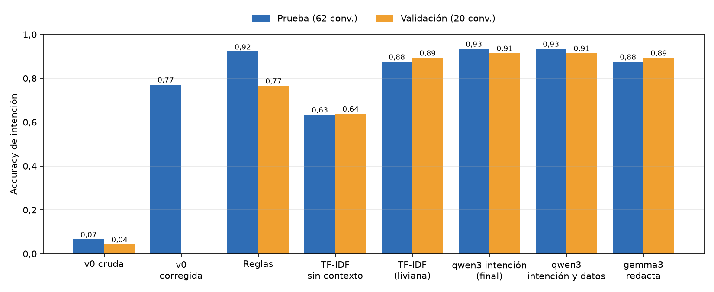

# Asistente de atención para RielSur

**Proyecto del curso Procesamiento del Lenguaje Natural, Universidad Adolfo Ibáñez, noviembre de 2026.**
Autor: Felipe Retamal. Repositorio: [github.com/feliperetamalj/Proyecto-Procesamiento-Lenguaje-Natural](https://github.com/feliperetamalj/Proyecto-Procesamiento-Lenguaje-Natural)

## Resumen

Construí un chatbot en Python que atiende a los clientes de RielSur, una empresa de trenes ficticia entre Santiago y Chillán. En cada mensaje detecta la intención del cliente, extrae los datos que entrega y responde sin inventar información. Siguiendo el enunciado, la primera versión (v0) la escribió qwen3:4b solo con un prompt. La v0 corre, pero contesta "No entiendo tu mensaje" a todo por un error en la llamada a Ollama. A partir de ahí armé un asistente por piezas y comparé, una pieza a la vez, versiones con un LLM contra versiones más simples. La versión final usa el mismo qwen3:4b de la v0 solo para detectar la intención, ahora con salida JSON y con el trámite en curso en el prompt; los datos los extraen expresiones regulares y las respuestas salen de plantillas que toman cada cifra de la base de conocimiento. En 62 conversaciones de prueba logra 0,935 de accuracy en intención, 1,000 de F1 en datos y ninguna respuesta inventada; en 20 conversaciones nuevas de validación logra 0,915 y 0,953. Una versión liviana con TF-IDF en vez del LLM queda cerca (0,876 y 0,894) y responde en milisegundos. La versión donde un LLM redacta las respuestas suena más natural, pero en la revisión a mano inventó algo en 69 de 153 respuestas.

## 1. El problema

El enunciado ofrece tres proyectos para la start-up Lang-Chi. Elegí el tercero: un asistente de atención en Python para un servicio a elección, evaluado con al menos 50 conversaciones de prueba en tres aspectos: intenciones detectadas, datos extraídos y respuestas inventadas. Solo se pueden usar modelos locales; usé qwen3:4b y gemma3:4b en Ollama 0.40.17, en un MacBook Air con chip M4 y 16 GB de RAM.

Elegí un servicio de trenes porque tiene datos con estructura clara (estaciones, horarios, tarifas, RUT, códigos de reserva) y porque es fácil saber si una respuesta es verdadera: un precio o un horario está en la base o no está. RielSur es ficticia para no dar información falsa sobre una empresa real.

El asistente reconoce once intenciones (saludo, despedida, comprar pasaje, consultar horario, consultar precio, cambiar pasaje, devolver pasaje, equipaje y mascotas, estado del tren, reclamo y fuera de alcance) y once datos (origen, destino, fecha, hora, pasajeros, tarifa, clase, RUT, correo, código de reserva y nombre).

## 2. La base de conocimiento

Todo lo que el asistente puede afirmar está en `data/base_conocimiento.json`, que genera `scripts/construir_base_conocimiento.py`. Contiene 8 estaciones con sus distancias y tiempos, los horarios de los dos sentidos para días hábiles y fines de semana, 28 tramos con precio estándar y preferente, cuatro tarifas (adulto, estudiante con 30% de descuento, adulto mayor con 40% y niño con 50%), las políticas de compra, cambio, devolución, equipaje, mascotas y reclamos, y 5 reservas de ejemplo para probar cambios y devoluciones. Los precios se calculan con una fórmula por kilómetro y los horarios con los minutos desde Santiago, así que son consistentes entre sí.

## 3. La v0, hecha por la IA

### 3.1 Cómo la pedí

Escribí un solo prompt (`prompts/prompt_v0.md`) con la tarea, las intenciones y los datos, las reglas (no inventar, recordar los datos de turnos anteriores, usar solo modelos locales), la firma exacta de la función `procesar_turno` que iba a usar para evaluar y la base de conocimiento completa. El script `scripts/generar_v0.py` se lo envía a qwen3:4b y guarda la respuesta sin tocarla, junto con el prompt exacto, el razonamiento del modelo y los hashes SHA-256.

qwen3:4b razonó durante 31.940 caracteres y escribió un archivo de 112 líneas. En total generó 9.166 tokens en 6,5 minutos. No agregó la explicación que le pedí después del código. La v0 quedó en `v0_cruda/qwen3_4b/` en un commit que solo contiene esos archivos.

### 3.2 Qué hace y qué pasó al ejecutarla

La v0 usa el mismo qwen3:4b para detectar la intención y los datos de cada mensaje (le pide un JSON) y después elige una respuesta fija según la intención. La ejecuté tal cual, desde la raíz del repositorio. Corre sin errores, pero responde "No entiendo tu mensaje. Por favor, describe tu consulta más claramente." a todo.

La causa está en la llamada a Ollama: manda el texto en un campo `prompt` al endpoint `/api/chat`, que espera una lista `messages`. Ollama no reclama; solo carga el modelo y devuelve un contenido vacío. El `json.loads` sobre ese texto vacío falla, un `except` lo ataja en silencio y la intención queda en `fuera_de_alcance`. Lo reproduje con curl en `resultados/ejecucion_v0/diagnostico_ollama.txt`.

Con las 62 conversaciones de prueba, la v0 obtiene 0,065 de accuracy en intención (solo acierta los turnos cuya respuesta correcta era justo `fuera_de_alcance`), F1 de 0,000 en datos y no reconoce ninguna de las 14 preguntas sin respuesta en la base.

## 4. Explicación de la v0

El recorrido línea por línea está en `docs/01_explicacion_v0.md`. Encontré cuatro errores de programación:

1. El campo `prompt` en vez de `messages` en `/api/chat`.
2. Lee el JSON con `json.loads` directo, aunque el modelo a veces lo envuelve en un bloque de código o escribe la clave `"intención"` con tilde.
3. El estado solo actualiza claves que ya existen; como parte vacío, nunca guarda nada.
4. Para saber qué datos faltan en una compra, mira el mensaje actual y no el estado acumulado.

Y dos problemas de diseño. El prompt interno no recibe la fecha de hoy ni el trámite en curso, así que el modelo no puede convertir "mañana" en una fecha ni entender que "15678901-1" es la respuesta a una pregunta anterior. Además, las respuestas de horarios, precios y equipaje son textos de relleno como "[Listado de horarios en la base de conocimiento]": el modelo describió lo que había que hacer en vez de programarlo. También encontré una respuesta inventada: cuando cree que la compra está completa dice "Tu pasaje será confirmado en 30 minutos", y la base dice que lo que vence en 30 minutos es el enlace de pago.

Para medir el diseño y no los errores hice `versiones/v0_corregida/chatbot.py`, una copia con solo esas cuatro correcciones marcadas en el código. Con ellas, la intención sube a 0,771 y los datos a 0,873 de F1, pero el asistente sigue sin contestar lo que se le pregunta: menciona el dato esperado en 2% de los casos, porque 36 de sus 153 respuestas son textos de relleno y 21 son "No entiendo tu mensaje". Las 3 compras que llega a cerrar terminan con la frase inventada del pasaje confirmado en 30 minutos. Además tarda 96 segundos por turno, porque qwen3:4b razona antes de cada respuesta.

## 5. Cómo evalué

La metodología completa está en `docs/02_evaluacion.md`. Las ideas principales:

- **62 conversaciones de prueba** (153 turnos) escritas a mano, cada turno con su intención, sus datos normalizados y, cuando corresponde, lo que la respuesta debe mencionar (por ejemplo, el total correcto de una compra). Incluyen casos difíciles a propósito: un horario que no existe, una fecha a más de 30 días, ocho pasajes cuando el máximo es seis, una reserva inexistente y 14 preguntas que la base no responde (wifi, clima, Puerto Montt).
- **20 conversaciones de validación** (47 turnos) que escribí cuando el código ya estaba cerrado. Las subí al repositorio antes de evaluar con ellas y no cambié nada después de ver los resultados.
- **Intención:** accuracy y macro-F1. **Datos:** precisión, recall y F1 campo por campo.
- **Respuestas inventadas:** un detector automático saca de cada respuesta los montos, horas, porcentajes, códigos, correos, páginas y teléfonos, y revisa que existan en la base, se puedan calcular con ella o los haya dicho el usuario. En las preguntas sin respuesta en la base revisa que el asistente reconozca que no sabe. Como el detector no entiende el sentido de la frase, las respuestas redactadas por un LLM las revisé además a mano.
- **Menciona lo esperado:** la proporción de datos esperados que aparecen en la respuesta. Hace falta porque un asistente que no dice nada tampoco inventa nada.

## 6. Versiones y comparaciones

El enunciado pide comparar con versiones simplificadas. Para eso armé el asistente en cuatro piezas intercambiables (`chatbot/`):

1. **Datos** (`extraccion.py`): expresiones regulares y la lista de estaciones. Entiende RUT con o sin puntos, fechas relativas ("mañana", "el viernes", "el 3 de diciembre"), horas habladas ("las 7 y media", "las 6 de la tarde") y cantidades ("somos dos", "uno no más").
2. **Intención** (`intenciones.py`): reglas con palabras clave, TF-IDF de caracteres y palabras con regresión logística entrenada con 220 frases (`data/frases_entrenamiento.json`, escritas aparte de las conversaciones de prueba), o un LLM local con salida JSON.
3. **Contexto** (`asistente.py`): si el mensaje solo trae datos o es una confirmación ("ok, dale"), sigue el trámite en curso. Si después de una consulta llega un RUT o un correo, pasa a la compra.
4. **Respuesta** (`respuestas.py`): plantillas que sacan cada precio, horario y política de la base, o un LLM que redacta con la base completa en el prompt.

Cada versión cambia una sola pieza respecto de otra, para que se vea qué aporta cada cambio.

### 6.1 Resultados en las conversaciones de prueba

| Versión | Intención acc. | Intención macro-F1 | Datos F1 | Resp. inventadas | Reconoce que no sabe | Menciona lo esperado | s/turno |
|---|---|---|---|---|---|---|---|
| v0 cruda | 0,065 | 0,011 | 0,000 | 0% | 0 de 14 | 0% | <0,01 |
| v0 corregida (qwen3:4b, sin contexto) | 0,771 | 0,773 | 0,873 | 0% | 0 de 14 | 2% | 96 |
| Reglas + regex + plantillas | 0,922 | 0,914 | 1,000 | 0% | 13 de 14 | 92% | <0,01 |
| TF-IDF sin contexto | 0,634 | 0,664 | 1,000 | 0% | 10 de 14 | 67% | <0,01 |
| TF-IDF + regex + plantillas (liviana) | 0,876 | 0,861 | 1,000 | 0% | 10 de 14 | 88% | <0,01 |
| **qwen3:4b intención + regex + plantillas (final)** | 0,935 | 0,919 | 1,000 | 0% | 11 de 14 | 97% | 1,69 |
| qwen3:4b intención y datos | 0,935 | 0,919 | 0,867 | 1% | 11 de 14 | 73% | 4,90 |
| TF-IDF + gemma3:4b redacta | 0,876 | 0,861 | 1,000 | 13% | 14 de 14 | 35% | 8,28 |

La columna de respuestas inventadas es la del detector automático. En la v0 corregida no marca ninguna, pero a mano encontré 3 de 153 (`resultados/revision_manual/v0_corregida.json`): las compras que terminan en "Tu pasaje será confirmado en 30 minutos". El detector no las ve porque el 30 sí está en la base, aunque para otra cosa. Para la versión que redacta con gemma3:4b, la revisión a mano da 69 de 153 (45%), como explico en la sección 6.5. La única marcada en la versión donde qwen3:4b extrae los datos es un falso positivo del detector: el modelo tomó Linares como origen y la plantilla dio horarios reales de Linares, que no eran los que se preguntaban. Los tiempos son del MacBook Air. Los de la versión final los medí de nuevo con Ollama atendiendo solo esa evaluación; los de las otras versiones con LLM son aproximados, porque a ratos corrieron dos evaluaciones a la vez.

### 6.2 Intención: LLM contra TF-IDF contra reglas

Comparé tres formas de detectar la intención dejando todo lo demás igual (datos con expresiones regulares, contexto y plantillas):

- **Reglas a mano:** 0,922 en prueba, pero las escribí mirando esas conversaciones y en validación caen a 0,766.
- **TF-IDF con regresión logística:** 0,876 en prueba y 0,894 en validación. Aprendió de 220 frases escritas aparte, sin GPU, y clasifica en milisegundos. Sus errores típicos son confundir una consulta de precio con una compra y un reclamo por un cobro doble con una devolución.
- **qwen3:4b con salida JSON y contexto:** 0,935 en prueba y 0,915 en validación, el mejor en los dos conjuntos. Le paso una descripción corta de cada intención y la intención del trámite en curso, y le pido JSON sin razonamiento (`format: "json"`, `think: false`). Sus errores se concentran en `fuera_de_alcance`: "¿se puede fumar en el tren?" lo manda a equipaje.

El modelo de esta versión es el mismo de la v0. La diferencia entre 0,771 (v0 corregida) y 0,935 sale del prompt: descripciones de cada intención, el trámite en curso y salida JSON sin razonamiento. Esto último además baja el tiempo de unos 96 segundos por turno a 1,69. En validación, la macro-F1 del LLM (0,844) queda bajo la de TF-IDF (0,886) aunque su accuracy es mayor; con solo 47 turnos, un error en una clase chica (una despedida que tomó por saludo) pesa mucho en el promedio por clase.

### 6.3 Datos: LLM contra expresiones regulares

Aquí la versión simple gana. Con las expresiones regulares el F1 de datos es 1,000 en prueba y 0,953 en validación; si además le pido los datos a qwen3:4b en el mismo JSON, baja a 0,867 y 0,824. Un tercio de sus errores son fechas: convierte "el viernes" o "el domingo" en la fecha de hoy y pone el 15 de enero en 2026 en vez de 2027. También cambia dígitos del RUT ("198760112-9"), devuelve "Mi Mamá" como nombre, "Bus" como origen y "Domingo" como destino. Las fechas relativas y los RUT tienen reglas exactas, y una expresión regular las aplica siempre igual.

Esta versión también encontró un error mío: en la primera corrida el modelo devolvió `"tarifa": "TNE"` y el asistente se cayó al buscar esa tarifa. Desde entonces, cualquier tarifa o clase que no esté en la lista se descarta antes de usarla.

### 6.4 El contexto es lo que más aporta

Para medir el contexto usé TF-IDF, que no tiene ninguno propio. Sin memoria del trámite, TF-IDF clasifica cada mensaje aislado y falla en todos los que solo traen datos ("Estándar", "15678901-1", "jp.soto@hotmail.com"). Con la regla de contexto, la accuracy de intención sube de 0,634 a 0,876 en prueba y de 0,638 a 0,894 en validación. La mención de datos esperados sube de 67% a 88%, porque la compra llega hasta el resumen con el total. Es el mismo problema de diseño de la v0: su prompt pedía seguir el trámite en curso, pero nunca le decía al modelo cuál era.

### 6.5 Respuestas: plantillas contra un LLM que redacta

En la versión que redacta, gemma3:4b recibe la base completa, el historial y los datos acumulados, con la instrucción de usar solo la base y decir cuando no sabe. Esto último lo cumple muy bien: reconoce las 14 de 14 preguntas sin respuesta. Pero cuando sí hay que dar cifras, se equivoca seguido. Revisé a mano sus 153 respuestas (`resultados/revision_manual/llm_respuestas.json`) y 69 afirman algo falso o que no está en la base:

| Tipo de error | Respuestas | Ejemplo |
|---|---|---|
| Precio | 16 | Santiago a Talca a $14.000 por pasajero; cuesta $7.000 |
| Política | 16 | Exige avisar con 48 horas para llevar una mascota |
| Horario | 13 | "El primer tren sale a las 06:30"; sale a las 07:30 |
| Disponibilidad o fecha | 11 | Dice que el viaje de mañana "ya ocurrió" |
| Correo mal escrito | 8 | Escribe atención@rielsur.cl, con tilde |
| Acción que no ocurre | 3 | Inventa un código de reserva nuevo, RS-98765 |
| Dato de la conversación | 2 | Cambia el destino de la reserva del cliente |

El detector automático marcó 20 de esas 69, todas correctas, pero no ve las demás: un precio equivocado que existe en otra parte de la base, o una política inventada sin números, pasan como válidos. Por eso la tasa automática de 13% subestima el problema. Las plantillas, en cambio, no pueden inventar una cifra porque cada una sale de la base. Revisé también a mano las 153 respuestas de la versión final (`resultados/revision_manual/llm_intencion_regex.json`): ninguna trae un dato falso. Sus 10 errores son de intención y terminan en respuestas verdaderas que no contestan la pregunta. Por ejemplo, a "¿Los trenes tienen wifi?" responde con la política de equipaje, y a "¿El tren tiene acceso para silla de ruedas?" también, aunque la base sí tiene esa información.

### 6.6 Validación: quién generaliza

| Versión | Intención acc. (prueba → validación) | Datos F1 (prueba → validación) | Menciona lo esperado (prueba → validación) |
|---|---|---|---|
| Reglas + regex + plantillas | 0,922 → 0,766 | 1,000 → 0,953 | 92% → 68% |
| TF-IDF sin contexto | 0,634 → 0,638 | 1,000 → 0,953 | 67% → 61% |
| TF-IDF + regex + plantillas (liviana) | 0,876 → 0,894 | 1,000 → 0,953 | 88% → 71% |
| **qwen3:4b intención + regex + plantillas (final)** | 0,935 → 0,915 | 1,000 → 0,953 | 97% → 75% |
| qwen3:4b intención y datos | 0,935 → 0,915 | 0,867 → 0,824 | 73% → 64% |

Las reglas de intención las escribí mirando las conversaciones de prueba y se nota: en conversaciones nuevas pierden 16 puntos. TF-IDF aprendió de frases que escribí aparte y se mantiene, y el LLM, que no aprendió de ninguna de las dos, también. Las expresiones regulares también bajan (F1 de 1,000 a 0,953): fallan con "ayer", con "es solo él" como cantidad de pasajeros y con "la 1 de la tarde". La v0 corregida no la evalué en validación porque nunca la ajusté con las conversaciones de prueba y cada turno le toma más de un minuto.



## 7. La versión final

La versión final es `chatbot/asistente.py` con su configuración por defecto: qwen3:4b con salida JSON y contexto para la intención, expresiones regulares para los datos, el trámite en curso como memoria y plantillas para responder. La elegí porque es la que mejor detecta la intención en prueba y en validación, la que más veces menciona lo que el cliente necesita saber, y no inventa datos. Su costo es la latencia: 1,69 segundos por turno en el MacBook Air, contra milisegundos de la versión con TF-IDF. Si Ollama no está disponible, la intención la decide TF-IDF, así que el asistente sigue funcionando. Para un servicio con mucho tráfico y sin GPU, la versión liviana es la que usaría.

Se usa por consola con `python -m chatbot.asistente`. Una conversación de ejemplo:

```
Usuario: ¿Cuánto sale un pasaje de Santiago a Talca?
RielSur: El pasaje adulto de Santiago a Talca cuesta: clase estándar: $7.000; clase preferente: $11.200.
Usuario: Quiero comprar 2 pasajes para el viernes
RielSur: El viernes 27 de noviembre los trenes de Santiago a Talca salen a las 07:30, 10:30, 14:00 y 18:30. ¿Cuál prefiere?
Usuario: A las 9
RielSur: No hay un tren que salga de Santiago a las 09:00 el viernes 27 de noviembre. Ese día salen a las 07:30, 10:30, 14:00 y 18:30. ¿Cuál prefiere?
Usuario: El de las 10:30, adultos, clase estándar
RielSur: Para terminar la compra necesito el RUT y el correo de quien compra.
Usuario: Mi rut es 17.234.567-0 y mi correo camila.rojas@gmail.com
RielSur: Resumen de su compra: 2 pasajes adulto en clase estándar, de Santiago a Talca, el viernes 27 de noviembre a las 10:30 (llega a las 13:00). Valor por pasaje: $7.000. Total: $14.000. El enlace de pago llegará a camila.rojas@gmail.com y vence en 30 minutos.
```

## 8. Conclusiones

- La v0 tenía una idea razonable (un LLM para entender y respuestas fijas para contestar), pero un error en la llamada a la API, escondido por un `except` silencioso, la dejó inútil. Revisar qué devuelve realmente el modelo fue más útil que leer el código.
- Recordar el trámite en curso es lo que más mejora la detección de intención. Sin contexto, ningún clasificador puede saber a qué trámite responde un mensaje como "15678901-1".
- Un clasificador clásico (TF-IDF con regresión logística) entrenado con 220 frases generaliza mejor que mis reglas a mano y queda a pocos puntos del LLM, sin GPU y en milisegundos.
- El mismo qwen3:4b que en la v0 no servía de nada, con un prompt mejor (descripciones, trámite en curso y salida JSON), es el mejor detector de intención que probé. Donde no conviene usarlo es en lo que tiene reglas exactas, como fechas y RUT, ni para redactar respuestas con cifras.
- Separar la comprensión de la respuesta permite garantizar que cada precio y horario sale de la base. Un LLM pequeño que redacta reconoce bien cuando no sabe, pero inventa cifras y políticas cuando cree que sí sabe.

## 9. Limitaciones y trabajo futuro

- Las conversaciones son un guion fijo: el usuario no reacciona a lo que dice el asistente. Sirven para comparar versiones, pero no reemplazan pruebas con personas.
- Las anotaciones y las conversaciones las escribí yo solo, sin una segunda persona que revisara los criterios.
- El detector de respuestas inventadas no entiende el sentido de la frase; para las versiones con LLM hizo falta la revisión a mano.
- El asistente no está conectado a un sistema de reservas. Cuando dice que registró un cambio o un reclamo, eso solo queda en el estado de la conversación.
- La extracción con reglas no cubre todo: "ayer", "es solo él", "quiero comprar 2 para el viernes" (sin decir "pasajes") o un nombre sin "me llamo". TF-IDF tampoco reconoce "wifi" como fuera de alcance porque ninguna frase de entrenamiento lo menciona.
- Como siguiente paso probaría un sistema híbrido: TF-IDF primero y el LLM solo cuando la confianza sea baja, y un LLM que redacte sobre la respuesta de la plantilla con una verificación automática de que cada cifra coincide con la base.

## Anexo: cómo reproducir

```
python3 -m venv .venv && .venv/bin/pip install -r requirements.txt
ollama pull qwen3:4b && ollama pull gemma3:4b
.venv/bin/python -m evaluacion.evaluar --sistema tfidf
.venv/bin/python -m evaluacion.evaluar --sistema tfidf --conversaciones data/conversaciones_validacion.json --salida resultados/validacion/tfidf
.venv/bin/python scripts/tabla_resultados.py
```

Los sistemas disponibles son `v0`, `v0_corregida`, `reglas`, `tfidf`, `tfidf_sin_contexto`, `llm_intencion_regex`, `llm_nlu` y `llm_respuestas` (ver `evaluacion/sistemas.py`).
